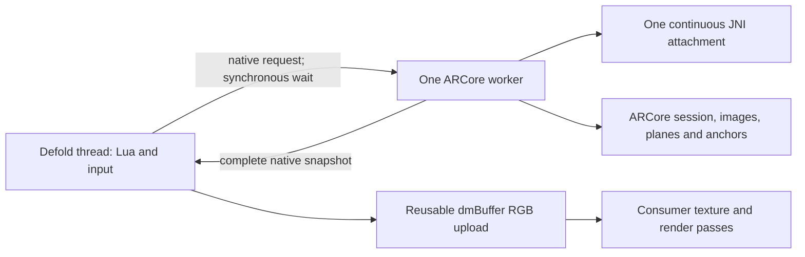

# Architecture and consumer integration

## Ownership



`arcore.cpp` validates Lua arguments, serializes jobs, publishes Lua values and
owns the engine buffer reference. `ar_worker.h` has one std::thread, a caller
mutex, a job mutex and completion condition variables. Its single
dmAndroid::ThreadAttacher starts before the first job and ends after final
cleanup. Defold input/window helpers can detach their own engine caller without
affecting this independent thread. The worker uses C++11 synchronization and runs unchanged in the Windows
real-JVM fixture; attachment scope and synchronous serialization are preserved.

`Session` is worker-owned. Its implementation is separated into session/loader/
capabilities (`ar_session.cpp`), frames (`ar_frame.cpp`), plane registry
(`ar_planes.cpp`), hit testing (`ar_hits.cpp`) and anchors (`ar_anchors.cpp`).
No Lua state, dmBuffer or texture handle enters a worker job.

## Loader and camera path

The Java application class loader locates `arcore_sdk_c` with
BaseDexClassLoader.findLibrary, then System.loadLibrary loads the C and JNI SDK
libraries. C++ dlopens the exact resolved path, including Android APK-contained
`base.apk!/lib/arm64-v8a/...` paths. All 92 mandatory exports must resolve before
publishing the API. A failed candidate is closed; a successful SDK is retained
until process exit because Java can retain native references.

`dynamicLibs: ["dl"]` is essential. Android's static libdl.a contains failing
stubs; the engine must dynamically import dlopen/dlsym/dlerror/dlclose from
libdl.so. APK verification checks this and every bound SDK export.

ARCore alone owns the camera. Texture mode EXPOSE_HARDWARE_BUFFER (API 27+)
avoids requiring Defold's GL context on the worker. The worker acquires an
ARCore CPU YUV_420_888 image, validates plane lengths/strides and allocation
size, converts to RGB, and releases the image promptly. The engine copies the
completed native RGB vector to a reusable Defold buffer, then Lua uploads a
normal RGB texture. This is a compatibility path with conversion/copy/upload
costs, not zero-copy. Camera images above the 64 MiB RGB safety budget are rejected.

All SDK matrices are copied column-major into Defold. The ARCore projection
convention is preserved, with near/far explicit in startup options. No zoom,
fake crop or synthetic camera transform is introduced.

## Snapshot and interaction consistency

Only a new camera timestamp with an acquired, valid image can refresh the
render snapshot. Its RGB, view/projection, display-oriented pose, UV mapping,
plane boundaries and all anchor poses are read during the same SDK update.
The complete native snapshot is handed back synchronously. Between complete
images, the prior render data stays unchanged while live tracking/status may
change. The 250 ms image-stall guard disables interaction.

Hit tests operate on the SDK's current frame. If an SDK update failed to
provide a complete image, that frame cannot be hit-tested or used for anchor
creation, even during the brief image-reuse interval. Expected frame/session
IDs reject outdated application requests. Public bottom-left view pixels
convert once to ARCore top-left view pixels; the image shader's UV transform
is never applied to input. Rotation/resize wait for a matching new image.

The Lua bridge tracks which frame was copied to dmBuffer. After a failed
buffer allocation, a later poll retries that copy before publishing its
matrices, including when the worker still has the same complete snapshot.

## Registry ownership and cleanup

Each discovered plane receives a session-scoped monotonic string ID. One
acquired reference is retained per plane until stop, including stopped and
subsumed planes; parent references have independent acquire/release pairs.
This deliberately trades session-length plane memory for unambiguous IDs
without pointer reuse. The registry has no gameplay use ledger.

Anchors have 16 slots and tokens containing session generation plus a never
reused serial. Releasing a slot never makes its token valid again. Each plane
attachment calls ArTrackable_acquireNewAnchor; an omitted plane explicitly
chooses ArSession_acquireNewAnchor. Failed attachments do not change modes.

Deactivation pauses the SDK on the worker and clears interaction readiness.
Activation resumes on the next poll and requires a new image. Permission is
checked again on polls, so revocation pauses the camera. The Java bridge
reconciles pending permission fragments across activity recreation and checks
permission from the current activity instead of retaining it as a strong global.

Stop detaches/releases anchors, releases plane references, pauses the session,
destroys lists, pose, frame and session. It clears image state and the engine
buffer reference. Finalization also deletes the Java global class reference,
then joins the worker; only afterward does its attachment detach from Java.

## Render integration

1. Add `/arcore_render/camera.mesh` to a consumer-owned game object.
2. From a game-object script create `camera.new("background#mesh")` and call
   `camera.upload(helper, frame)` for each fresh complete frame, before the next poll.
3. Send that same frame's view/projection to your render script. Keep the entire
   image/pose/anchor render snapshot together until the next fresh frame.
4. Draw tag `ar_camera` fullscreen, then world content with the AR matrices,
   then your UI. Hide interactive content on tracking/focus loss.
5. Release the helper with `camera.destroy(helper)` in final; stop the session.

The background quad uses clip-space coordinates directly. Its material samples
`uv0 + quad.x*(uv1-uv0) + quad.y*(uv2-uv0)`. The sample renderer disables depth
writes/test, blending, culling and stencil for this opaque background, restores
depth for its markers and uses blending/stencil for GUI. A consumer must set
and restore the appropriate states for its own passes. The library does not
draw or modify render state from its upload helper.

## AR Optional consumers

The default library is AR Required. An Optional application can supply these
overrides in its own merged Android manifest (with the tools namespace):

```xml
<manifest xmlns:android="http://schemas.android.com/apk/res/android"
          xmlns:tools="http://schemas.android.com/tools"
          package="{{android.package}}">
    <uses-feature android:name="android.hardware.camera.ar"
        android:required="false" tools:replace="android:required" />
    <uses-feature android:name="android.hardware.camera"
        android:required="false" tools:replace="android:required" />
    <application>
        <meta-data android:name="com.google.ar.core" android:value="optional"
            tools:replace="android:value" />
    </application>
</manifest>
```

Select that manifest in the consumer's game.project and inspect the merged
APK. Keep minimum API 27 for this extension's camera path. Handle unavailable
services, unsupported_device and denied permission in your own non-AR flow.
Optional metadata does not make an unsupported device track or automatically
install/update services. Prepare services separately before offline use. The
library does not remove your application's Internet, network-state or other
unrelated permissions; any such removal belongs in the consumer manifest.
